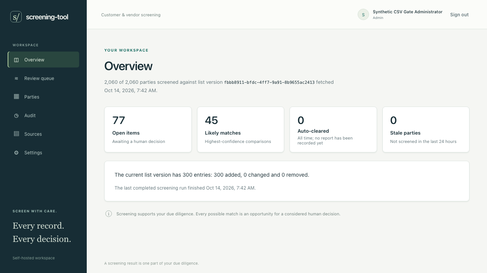
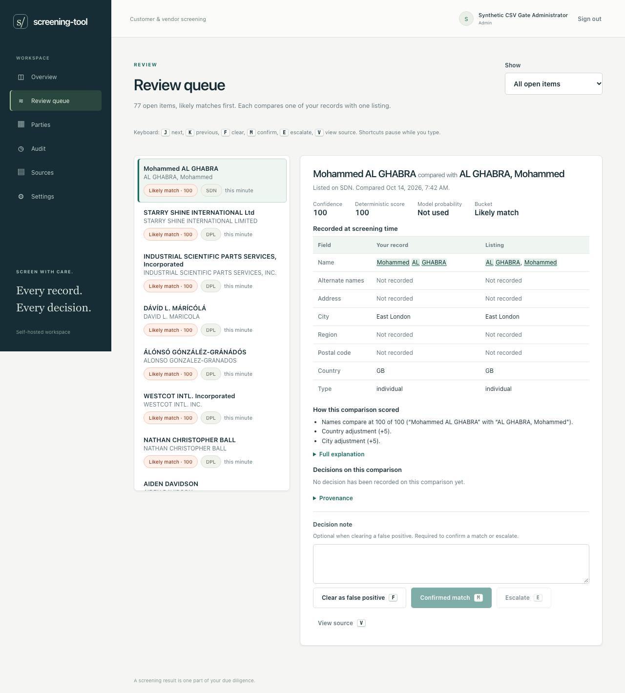

# screening-tool

**Screening results are not legal advice.** Independently verify potential matches and consult qualified counsel when needed.

Self-hosted customer and vendor screening against the U.S. Consolidated Screening List (CSL). Python/FastAPI/SQLite and React, in one container. MIT licensed.

CSV/XLSX import, deterministic screening, human review, monitoring, exports and optional model workflows are included. See [automated validation](https://github.com/jam649/screening-tool/actions/workflows/ci.yml) and [versioned releases](https://github.com/jam649/screening-tool/releases) for build status.

> **QuickBooks Online and Business Central: live validation needed.** Both integrations are implemented and tested against fixtures, including packaged API, browser and restart checks. Neither has been validated in a live vendor sandbox or production tenant. We welcome [pull requests documenting live validation](#help-validate-live-integrations), with any fixes or sanitized regression tests.

## Start locally

Install Docker with Compose, then:

```bash
git clone https://github.com/Jam649/screening-tool.git
cd screening-tool
# Generate once. The subshell refuses to replace an existing .env and creates it private.
(umask 077; set -o noclobber; docker run --rm python:3.12-slim-bookworm@sha256:34386ef0cb081344d7ec1c103ba398e6e9f64e9ab3a1509accc92a4e24a07258 python -c 'import base64,secrets; print("SCREENING_TOOL_SECRET_KEY="+base64.urlsafe_b64encode(secrets.token_bytes(32)).decode())' > .env)
docker compose up --build -d --wait
```

Open **http://localhost:8000**, create the first administrator (password at least 12 characters), and acknowledge the ITA notice. The service binds to loopback by default. Use a TLS reverse proxy for access from other machines: session cookies are always Secure, HttpOnly, and SameSite=Lax. Chromium permits Secure cookies on localhost; remote plain HTTP cannot carry the login session.

Keep `.env` private and back up its key with the data volume. The key encrypts connector/model/SMTP credentials, not the SQLite database itself. Put the Docker data volume on an encrypted disk. Losing the key makes stored credentials unreadable; generate it once per deployment and keep it across upgrades.

For public access, add these nonsecret settings to your existing private `.env`, keeping its original encryption key:

```dotenv
SCREENING_TOOL_ALLOWED_HOSTS=["screening.example.com"]
SCREENING_TOOL_ALLOWED_ORIGINS=["https://screening.example.com"]
# The actual IP/CIDR of the proxy connecting to the container, not its public hostname.
SCREENING_TOOL_FORWARDED_ALLOW_IPS=127.0.0.1,::1
```

Replace the example hostname and proxy addresses with your deployment's values. Hostnames and HTTPS origins are exact; the default accepts only loopback hosts. The readiness probe connects to loopback with a configured allowed Host, so public-only host lists remain healthy. Put a TLS reverse proxy in front, retain the original Host, and have that proxy overwrite `X-Forwarded-Proto` and `X-Forwarded-For` with the real scheme and client address. Explicitly trust only the connecting proxy IPs/CIDRs; never use wildcard trust. For a host proxy reaching Docker's mapped port, the connecting address may be the Docker bridge gateway rather than 127.0.0.1: inspect your network and configure that exact trusted address. Correct client forwarding keeps the persistent per-address sign-in limit separate for remote users. Restrict direct access to the internal HTTP port and omit query strings from proxy logs. Run only one API worker because the scheduler is inside the process. Run operator commands with `docker compose exec` in that same service. Do not start a second service or `docker compose run` process against its retained volume: operation leases use the service’s process namespace, and cross-container workers are not supported. Do not expose the initial wizard until you are ready to create the Admin.

To upgrade, back up the data volume and its original `.env`, pull the desired signed release, then run `docker compose up --build -d --wait`. Do not regenerate the key or remove the data volume. Completed historical evidence remains immutable; after a documented matching-policy upgrade, run `docker compose exec screening-tool screening-tool screen --all` to establish current coverage under the new policy.

## Screen the synthetic demo

The included demo uses synthetic customers/vendors and a frozen 300-entry public CSL sample. It demonstrates the workflow; use **Fetch CSL now** for a current government list before screening a real book.

1. Complete the Admin and ITA acknowledgment steps above.
2. In another terminal, load the packaged public sample:

   ```bash
   docker compose exec screening-tool screening-tool csl refresh --file /app/fixtures/csl_sample_v1.json
   ```

3. Reload the browser, follow **Add source**, and download the synthetic CSV from Sources. Add a CSV source named “Synthetic demo,” then upload that download. Preview shows the first 20 rows. Map each header to its same-named field; include `external_id` and `address_lines`. Confirm that it is the complete source snapshot and select **Import file**.
4. After its screening task finishes, open **Overview** and **Review queue**. There are 2,060 synthetic parties and planted matches. Select a comparison; use `J`/`K` to move, `F` for a false positive, or `M`/`E` with a note. Original decisions and later changes stay on the party file. Raw original evidence is expandable without covering the business field changes.
5. For actual data, fetch the current CSL and add a separate complete source export. Re-uploading a source is a full snapshot: missing records become inactive, retaining history. Do not upload a partial customer/vendor file as a complete book.

## Screenshots

Captured from the actual packaged application with the synthetic 2,060-party demo and frozen 300-entry public CSL sample. These images show demo screening and human review, not a current-list assessment of real customers.





## Matching evidence and limits

The independent frozen recall corpus contains 120 positive and 60 negative pairs. The default policy finds all **80 must-find cases** and **114 of 120 broader positives**, with no negative control scoring as likely. Six cross-script cases remain below the stored-candidate cutoff: one Arabic and five Hangul examples. These measured gaps remain visible in the [recall and performance report](docs/research/matching-recall.md); this small synthetic corpus does not establish universal name recall.

Matching policy version 2 supplements token/phonetic blocking with character trigrams and removes the sparse-fallback truncation. It retains complete original evidence, exact false-positive memory and deterministic scoring. Upgrades invalidate current-coverage claims under the old scoring policy; run `screen --all` to establish new coverage. The constrained 20,000-party/25,000-entry cold/repeat release benchmark is pending; its report must distinguish measured resource limits from universal performance guarantees.

## Operator commands and backups

These run the same services as persistent schedules:

```bash
docker compose exec screening-tool screening-tool init
docker compose exec screening-tool screening-tool csl refresh
docker compose exec screening-tool screening-tool sync SOURCE_UUID
docker compose exec screening-tool screening-tool screen --changed
docker compose exec screening-tool screening-tool screen --all
docker compose exec screening-tool screening-tool report send
docker compose exec screening-tool screening-tool alert send
docker compose exec screening-tool screening-tool bc subscriptions SOURCE_UUID
docker compose exec screening-tool screening-tool monitor recover
docker compose exec screening-tool screening-tool retention preview
```

Recovery preserves queued work's original source, party and actor. A still-busy or failed operation exits nonzero and stays visible in monitoring. Retention is disabled by default, has a five-year floor, and requires proven eligibility with no active holds; it does not erase permanent audit or institutional provenance. Use **Settings** for timezone, schedules, thresholds, exact notices, SMTP and users. Scoring defaults are candidate 50, review 65, likely 90; advanced name ratios are 0.5 token-set, 0.25 token-sort and 0.25 partial, with country +5/−15, city +5, address up to +5, type mismatch −10 and short-name −10.

Back up the volume on encrypted storage together with its original private `.env`. For a consistent offline copy, stop this Compose service, archive its named data volume, then start the service with the same key. Verify restoration in a separate deployment before relying on a backup. Never use `down --volumes` on retained data. SMTP acceptance is not proof of delivery when the connection is lost; uncertain retries are explicit and preserve the frozen report.

CLI audit and training exports create complete mode-0600 files and refuse existing destinations, including symlinks. Choose a new output filename each time. CSV/PDF/ZIP include original snapshots and checksum evidence; they contain commercially sensitive identity data and must remain private. Server downloads use no-store headers; protect your downloaded copies as well. Original hashes and evidence are retained across record/type/list changes; existing hash-rule-v1 caches require the explicit documented `hashes upgrade` followed by `screen --changed`.

## QuickBooks Online

**Unverified in a live Intuit sandbox or production company.** The connector is tested against synthetic responses derived from [official contracts](docs/research/vendor-contracts.md#quickbooks-online) and the real packaged application. Use your own Intuit developer app and validate it in a sandbox before production. Production credentials require Intuit's App Assessment; marketplace listing is a separate process.

1. Set the application's public base URL in **Settings → Email notifications**. Use public HTTPS for a remotely accessible deployment. Loopback HTTP is supported for a local OAuth callback.
2. Open **Settings → QuickBooks app settings**, choose Sandbox or Production, and save that environment's client ID and secret. Register the exact displayed redirect URI in Intuit. Saved credentials are encrypted and displayed as configured flags.
3. In **Sources**, add a QuickBooks source for each company, choose the same environment, and authorize it through Intuit while signed in as the initiating Admin. An app's configured keys and a company's authorized connection are separate states. Each source keeps its historical company identity after disconnect.
4. Connected sources poll customers and vendors on the monitoring schedule. **Sync changes** reads CDC; **Full sync** reconciles the whole book, including inactive records. Operations remain queued while a source is busy; their eventual counts and screening result appear after completion.
5. Webhooks are optional. Configure the environment's verifier token and displayed webhook URL in Intuit, then enable notifications on the source. This requires a connected company and a public HTTPS base URL. Signed notifications request an earlier poll; scheduled polling remains enabled.

Disconnect stops polling and preserves parties, reviews and history. Its status reports whether the remote grant was revoked, failed, or did not require revocation. A failed revoke retains encrypted retry material and exposes **Retry Intuit revocation**. Reconnect is required when refresh authorization expires or is withdrawn.

For an operator full reconciliation:

```bash
docker compose exec screening-tool screening-tool sync SOURCE_UUID --full
```

HTTP access logs are disabled; configure your reverse proxy to omit OAuth query strings as well. Callback responses use `Referrer-Policy: no-referrer`.

## Business Central

**Unverified in a live Business Central sandbox or production tenant.** The connector uses Microsoft's documented [service-to-service app authentication](https://learn.microsoft.com/en-us/dynamics365/business-central/dev-itpro/administration/automation-apis-using-s2s-authentication); company selection takes place inside this application.

1. Register your Entra app, create a client secret and grant the Business Central application permission `API.ReadWrite.All` with tenant consent. In Business Central's **Microsoft Entra applications** page, enable that application and assign the object permissions needed for company/customer/vendor reads and subscription management. Microsoft prohibits assigning `SUPER` to applications. The precise restricted permission set must be checked in your tenant before live use.
2. In **Settings → Business Central app settings**, save the application UUID and secret. One encrypted app configuration serves the sources. Saved values appear as configured flags; omitted fields preserve them.
3. In **Sources**, add a Business Central source with its tenant UUID and actual environment name, discover accessible companies, and explicitly connect the selected company. One source serves one company. The bound company identity remains permanent after disconnect; another company needs another source.
4. Connected sources poll changes using an overlapping timestamp filter. A daily full reconciliation detects hard deletions; **Full sync** requests one immediately. Posting restrictions such as `blocked` leave a party active for screening.
5. For optional webhooks, configure a public HTTPS base URL in **Settings → Email notifications** and enable them on the connected source. The app registers customer/vendor subscriptions, validates each challenge and verifies each delivery's private client state. Actual subscription expiries and failed cleanup are visible. A persistent 12-hour reconciliation job renews subscriptions when due; polling continues.

Disconnect stops polling immediately and preserves records and review evidence. It removes the app's remote webhook subscriptions and reports failures with an encrypted retry obligation. Entra app consent remains under your tenant administrator's control. Configure your reverse proxy to omit webhook validation query strings; application HTTP access logging is disabled.

Packaged fixture checks cover these workflows; live tenant compatibility remains unverified.

## Help validate live integrations

QuickBooks Online and Business Central sandbox testing would help establish real integration compatibility. **Documentation-only validation pull requests are welcome**, as are fixes accompanied by sanitized regression tests. Please follow [the contribution and DCO guidance](CONTRIBUTING.md) and include:

- The platform, sandbox environment, test date, relevant API/version information and app permissions used.
- The scenarios tested and their results: connection/company selection, initial and incremental sync, updates and deletions/inactive records, reconnect/disconnect, and optional webhooks/subscriptions if exercised.
- Reproduction steps for failures and synthetic examples or redacted evidence sufficient to assess the result.

Use synthetic customers/vendors in the sandbox. Keep credentials, tokens, tenant/company identifiers, customer data, databases and raw logs out of the pull request. Record what was actually tested; a successful sandbox run validates that configuration, not every production environment.

## Optional models and training pairs

Deterministic screening works without an API key. In **Settings → Model settings**, select None, local Laya or hosted Jev. Defaults are `w_det=1`, `w_model=0`: the measured base Laya checkpoint did not discriminate these screening identities reliably. An enabled model can record its probability while scores remain deterministic. Use a positive model weight only after checking representative held-out human decisions. A strong deterministic match always stays in the likely bucket; unavailable or invalid inference keeps the deterministic score and records a fallback.

For Laya, run its server separately on this machine with the verified multilingual checkpoint and 1024-token limit; see [the pinned runtime and quality report](docs/research/laya-validation.md) and [serving contracts](docs/research/model-adapters.md#local-laya). In the Compose app, use `http://host.docker.internal:8009` for a host server on port 8009; a noncontainer development backend can use `http://127.0.0.1:8009`. The endpoint accepts only this host's loopback or explicit Docker host bridge. The application includes the exact offline tokenizer, not model weights or a Laya server. Keep the local server private; an optional Laya key is write-only. Save the configuration before using **Test saved configuration**, which sends synthetic identity fields and reports actual model/usage or a fixed failure code. Changing a draft does not test or save it.

For Jev, obtain your own TypeSafe account/key; entitlement and billing are not verified by this project. Before saving the key, acknowledge the displayed sentence: “Enabling Jev sends your customer and vendor names and addresses to TypeSafe AI for scoring. Laya keeps all data on this server.” The adapter uses the fixed `jev-1.13.0` contract. Keys remain encrypted and display only configured flags; explicit clear controls remove them. Provider and weight changes queue a full screening and retain original settings on previous runs.

Export retained human labels for a separate fine-tuning workflow:

```bash
docker compose exec screening-tool screening-tool export training-pairs --output /data/training-pairs.csv
docker compose cp screening-tool:/data/training-pairs.csv ./training-pairs.csv
```

This file contains commercially sensitive identity evidence. Keep it private. Select rows with `row_type=training_pair`; the `manifest` row contains counts and the ITA notice, not a label. Only actual human false-positive and confirmed-match decisions are included, with original snapshots, actor and fanout provenance. Missing or purged evidence is counted as unavailable. Running a fine-tune is outside v1. The [model adapter contracts](docs/research/model-adapters.md) distinguish synthetic checks, actual local inference and unverified direct hosted access.

## Measured Jev cost and Laya comparison

On October 14, 2026, both models evaluated the **same 120 synthetic/public-list pairs**, using identical state and question text and fresh sequential calls. There were 45 same-identity and 75 different-identity labels; answers and labels were kept separate. Jev used OpenRouter’s dated `typesafe/jev-1.13-20260917` model. Laya used the pinned base multilingual checkpoint locally on Apple MPS. The [complete comparison report](docs/research/jev-laya-comparison.md) records the reproducible corpus, timing, costs and limits.

| Measurement on these 120 pairs | Jev through OpenRouter | Local Laya |
| --- | ---: | ---: |
| Accuracy at probability ≥ 0.5 | **87.5%** (105/120) | **36.7%** (44/120) |
| True matches found | 45/45 | 43/45 |
| False positives among 75 negatives | 15 | 74 |
| Ranking discrimination, AUROC | 1.000 | 0.319 |
| Median request latency | 194 ms | 61 ms |
| 95th-percentile request latency | 306 ms | 96 ms |
| Reported API charge for all 120 | **$0.003261426** | **$0**; local hardware/electricity separate |

Jev reported 77,653 input tokens and 2,520 output tokens; all 120 individual charges match the published input rate of $0.042 per million tokens, with free output. The measured average is **$0.00002718 per comparison**: approximately **$0.027 per 1,000**, **$0.272 per 10,000**, or **$2.72 per 100,000** at the same input size and price. These are comparisons selected for AI, not one call per party or every party/list combination. Full-book costs depend on candidate counts, the AI eligibility cutoff and remembered human decisions. OpenRouter credit-purchase fees and taxes are outside reported inference usage; Laya hardware and electricity were not measured. Current [OpenRouter pricing](https://openrouter.ai/typesafe/jev-1.13) can change.

This is a small diagnostic corpus, not demonstrated production accuracy. It includes 65 pairs below the production AI eligibility cutoff. Both models misclassified all ten common-name/country negatives and all five address-only negatives at 0.5. The deterministic heuristic scored 90.8% on this same corpus at score 50; its score is not a calibrated probability. No threshold was tuned after seeing these labels, and no application weights changed. Keep the default deterministic 1/0 blend until representative held-out human decisions support a different policy.

The live benchmark uses [OpenRouter’s Decisions API](https://openrouter.ai/docs/api/api-reference/alphadecisions/submit-a-decisions-request). The application’s current Jev Settings require a direct TypeSafe API key; OpenRouter keys are used by the research comparison harness. Raw provider records and credentials remain private and off GitHub.

## Repository layout

Application code lives in `backend/` and `frontend/`; frozen public/synthetic inputs and expected outcomes live in `fixtures/`. Maintained packaged checks are organized by feature in [tests/integration](tests/integration/README.md), with unit/API/browser tests alongside their applications. Research tools live in `scripts/research/`; public research, UI guidance and third-party notices live in `docs/`. Maintainer plans, milestone/review records, the original design brief, local tool configuration, checkpoint harnesses, credentials and raw/runtime outputs stay local. The public [design system](docs/design-system.md) documents the visual conventions. The maintainer's `.gitignore` stays local; contributors should configure the [documented local exclusions](CONTRIBUTING.md).

## Development checks

Use Python 3.12 and `uv` 0.11.31 or newer, Node 22.12+ and npm:

```bash
cd backend
uv sync --frozen --extra dev
uv run ruff check . ../tests/integration ../scripts/research
uv run mypy app
uv run pytest -c pyproject.toml tests ../scripts/research/test_compare_adjudicators.py
uv run pip-audit
cd ../frontend
npm ci
npm run lint
npm run typecheck
npm run build
npx playwright install chromium
npm test
npm audit
```

The real first-run browser gate requires an isolated fresh database, then `PLAYWRIGHT_BASE_URL=http://localhost:8000 npm test -- tests/setup.spec.ts` from `frontend/`. The standard browser suite uses mocked API contracts; the real test is skipped unless a deployment URL is provided.

[Vendor verification](docs/research/vendor-contracts.md) · [Contributing and DCO](CONTRIBUTING.md)

This tool is one control in a compliance program, not the program. False negatives are possible. CSL data does not provide government endorsement of a result; users must conduct due diligence and make their own risk-based determinations. The complete ITA notice appears in setup and accompanies every export and report. HTTP access logs are disabled in the container so OAuth callback query credentials and party-search terms are not written to ordinary server logs; configure any reverse proxy to log paths without query strings.

Database upgrades preserve existing records. Destructive schema downgrades deliberately refuse to erase the audit trail. A stored encryption-key fingerprint makes a changed key fail at startup instead of silently making old credentials unreadable.
